# Database Schema & ER Diagram — KassaRitel POS

Database menggunakan SQLite relasional (`node:sqlite` `DatabaseSync`) dengan migrasi SQL berurutan di `server/db/migrations/`:
1. `001_initial_pos.sql` — Inti POS, transaksi, mutasi stok, pengaturan toko, dan audit log.
2. `002_auth_rbac.sql` — Pengguna, role, izin granular, sesi ter-hash, dan otorisasi PIN.
3. `003_product_catalog.sql` — Master produk lengkap, multi-barcode, gambar referensi AI, kategori hierarkis, merek, dan satuan UOM.
4. `004_pos_core_checkout.sql` — Pelanggan (`customers`), metode pembayaran terkonfigurasi (`payment_methods`), generator urutan dokumen (`document_sequences`), pembayaran multi-metode (`transaction_payments`), status transaksi & pembayaran, diskon per baris/transaksi, override harga, dan kunci idempotensi.
5. `005_receipt_printing.sql` — Snapshot struk historis (`receipt_snapshots`), riwayat cetak & cetak ulang (`receipt_print_logs`), serta konfigurasi logo dan lebar kertas pada `store_settings`.
6. `006_inventory_stock_control.sql` — Kontrol stok (`stock_receivings`, `stock_adjustments`, `stock_opnames`, `stock_opname_items`), pelacakan aktor/biaya/alasan pada `stock_movements` dengan `ON DELETE RESTRICT`, serta pengaturan `allow_negative_stock` pada `store_settings`.
7. `007_ai_product_recognition.sql` — Vektor embedding gambar referensi produk (`product_image_embeddings`), pengaturan ambang batas & provider AI (`recognition_settings`), dan log pengenalan serta umpan balik terverifikasi (`recognition_logs`).
8. `008_customer_promotion.sql` — Nomor keanggotaan & poin loyalitas pelanggan (`loyalty_settings`, `loyalty_point_transactions`), mesin promosi & target (`promotions`, `promotion_targets`), kebijakan stacking/diskon pada `store_settings`, serta jejak promo & loyalitas pada `transactions` & `transaction_items`.

---

## Entity Relationship Diagram (Mermaid)

```mermaid
erDiagram
    users ||--o{ user_roles : has
    roles ||--o{ user_roles : assigned_to
    roles ||--o{ role_permissions : grants
    permissions ||--o{ role_permissions : granted_by
    users ||--o{ sessions : owns
    users ||--o{ pin_authorizations : authorizes
    users ||--o{ audit_logs : performs

    categories ||--o{ categories : parent_of
    categories ||--o{ products : categorizes
    categories ||--o{ products : subcategorizes
    brands ||--o{ products : brands
    units_of_measure ||--o{ products : measures

    products ||--o{ product_barcodes : identified_by
    products ||--o{ product_images : illustrated_by
    product_images ||--o| product_image_embeddings : embedded_as
    products ||--o{ recognition_logs : matched_in
    products ||--o{ stock_movements : tracks
    products ||--o{ stock_receivings : receives
    products ||--o{ stock_adjustments : adjusts
    stock_opnames ||--o{ stock_opname_items : counts
    products ||--o{ stock_opname_items : counted_in

    customers ||--o{ transactions : places
    customers ||--o{ loyalty_point_transactions : tracks_points
    transactions ||--o{ loyalty_point_transactions : triggers
    promotions ||--o{ promotion_targets : targets
    transactions ||--o{ transaction_items : contains
    products ||--o{ transaction_items : sold_as
    transactions ||--o{ transaction_payments : settled_by
    payment_methods ||--o{ transaction_payments : via
    transactions ||--|| receipt_snapshots : freezes
    transactions ||--o{ receipt_print_logs : records_prints
```

---

## Ringkasan Tabel & Indeks

### 1. Modul Autentikasi & RBAC (`002_auth_rbac.sql`)
- **`users`**: `id (PK)`, `username (UNIQUE NOCASE)`, `email (UNIQUE NOCASE)`, `full_name`, `password_hash`, `pin_hash`, `is_active`, `last_login_at`, `created_at`, `updated_at`.
- **`roles`**: `id (PK)`, `name (UNIQUE NOCASE)`, `description`, `is_system`, `created_at`.
- **`permissions`**: `id (PK)`, `code (UNIQUE)`, `module`, `action`, `label`, `description`.
- **`user_roles`**: `user_id (FK -> users)`, `role_id (FK -> roles)`, `assigned_at` (`PK: user_id, role_id`). Index: `idx_user_roles_role`.
- **`role_permissions`**: `role_id (FK -> roles)`, `permission_id (FK -> permissions)` (`PK: role_id, permission_id`). Index: `idx_role_permissions_perm`.
- **`sessions`**: `id (PK)`, `user_id (FK -> users)`, `token_hash (UNIQUE)`, `refresh_token_hash (UNIQUE)`, `user_agent`, `ip_address`, `login_at`, `last_activity_at`, `expires_at`, `refresh_expires_at`, `revoked_at`. Indexes: `idx_sessions_user_id`, `idx_sessions_token_hash`, `idx_sessions_refresh_hash`.
- **`pin_authorizations`**: `id (PK)`, `authorizer_user_id (FK -> users)`, `requested_by_user_id (FK -> users)`, `action`, `reason`, `token_hash (UNIQUE)`, `expires_at`, `used_at`, `created_at`.

### 2. Modul Master Produk & Katalog (`001_initial_pos.sql` + `003_product_catalog.sql`)
- **`categories`**: `id (PK)`, `name`, `slug (UNIQUE NOCASE)`, `parent_id (FK -> categories.id ON DELETE SET NULL)`, `description`, `is_active`, `created_at`, `updated_at`.
- **`brands`**: `id (PK)`, `name (UNIQUE NOCASE)`, `description`, `is_active`, `created_at`, `updated_at`.
- **`units_of_measure`**: `id (PK)`, `code (UNIQUE NOCASE)`, `name`, `is_system`, `is_active`, `created_at`.
- **`products`**: `id (PK)`, `sku (UNIQUE NOCASE)`, `barcode (UNIQUE)`, `name`, `description`, `brand_id`, `category_id`, `subcategory_id`, `category`, `uom_id`, `unit`, `variant`, `size`, `weight`, `volume`, `cost_price`, `sell_price`, `special_price`, `tax_category`, `stock`, `min_stock`, `status`, `primary_image_id`, `created_at`, `updated_at`.
- **`product_barcodes`**: `id (PK)`, `product_id (FK -> products ON DELETE CASCADE)`, `barcode (UNIQUE NOCASE)`, `barcode_type`, `is_primary`, `created_at`.
- **`product_images`**: `id (PK)`, `product_id (FK -> products ON DELETE CASCADE)`, `file_name`, `mime_type`, `file_size`, `image_url`, `storage_path`, `is_primary`, `is_ai_reference`, `reference_angle`, `ai_embedding_status`, `created_at`.

### 3. Modul POS Core, Pelanggan, Pembayaran & Stok (`001_initial_pos.sql` + `004_pos_core_checkout.sql`)
- **`customers`**: `id (PK)`, `code (UNIQUE NOCASE)`, `name`, `phone`, `email`, `address`, `notes`, `is_active`, `created_at`, `updated_at`.
  - Indexes: `idx_customers_name`, `idx_customers_phone`.
- **`payment_methods`**: `id (PK)`, `code (UNIQUE NOCASE)`, `name (UNIQUE NOCASE)`, `type` (`CASH` | `DEBIT` | `CREDIT` | `QRIS` | `OTHER`), `requires_reference`, `is_system`, `is_active`, `sort_order`, `created_at`.
- **`document_sequences`**: `seq_key (PK)`, `last_number`, `updated_at` (menjamin nomor `TRX-YYYYMMDD-0001` & `HOLD-YYYYMMDD-0001` unik secara atomik).
- **`transactions`**: `id (PK)`, `invoice_number (UNIQUE)`, `status` (`NEW` | `IN_PROGRESS` | `HELD` | `CANCELLED` | `COMPLETED`), `payment_status` (`UNPAID` | `PARTIAL` | `PAID` | `CANCELLED`), `customer_id (FK -> customers ON DELETE SET NULL)`, `customer_name`, `subtotal`, `line_discount_total`, `transaction_discount_type`, `transaction_discount_value`, `transaction_discount_amount`, `discount_amount`, `apply_tax`, `tax_amount`, `total`, `cash_received`, `change_amount`, `payment_method`, `total_cost`, `gross_profit`, `notes`, `idempotency_key (UNIQUE)`, `cashier_id`, `cashier_name`, `held_at`, `cancelled_at`, `completed_at`, `created_at`, `updated_at`.
  - Indexes: `idx_transactions_created_at`, `idx_transactions_status`, `idx_transactions_customer`, `idx_transactions_idempotency`.
- **`transaction_items`**: `id (PK)`, `transaction_id (FK -> transactions ON DELETE CASCADE)`, `product_id`, `sku`, `barcode`, `name`, `unit`, `qty`, `original_sell_price`, `sell_price`, `price_override`, `cost_price`, `line_discount_type`, `line_discount_value`, `line_discount_amount`, `tax_category`, `tax_amount`, `subtotal`.
  - Index: `idx_transaction_items_trx`.
- **`transaction_payments`**: `id (PK)`, `transaction_id (FK -> transactions ON DELETE CASCADE)`, `payment_method_id (FK -> payment_methods ON DELETE SET NULL)`, `payment_method_name`, `payment_type`, `amount`, `tendered_amount`, `change_amount`, `reference_number`, `created_at`.
  - Index: `idx_transaction_payments_trx`.
- **`stock_movements`**: `id (PK)`, `product_id (FK -> products ON DELETE RESTRICT)`, `sku`, `product_name`, `barcode`, `type` (`PENJUALAN`, `RESTOK`, `STOCK_IN`, `ADJUSTMENT_IN`, `ADJUSTMENT_OUT`, `OPNAME`, `STOK_AWAL`), `qty_delta`, `stock_before`, `stock_after`, `unit_cost`, `reference_id`, `reason`, `notes`, `actor_user_id`, `actor_name`, `movement_date`, `created_at`. Indexes: `idx_stock_movements_created_at`, `idx_stock_movements_product`, `idx_stock_movements_type`, `idx_stock_movements_ref`.
- **`store_settings`**: `id (PK=1)`, `store_name`, `store_address`, `store_phone`, `store_logo_url`, `receipt_paper_width` (`58mm` | `80mm` | `A4`), `receipt_show_logo`, `receipt_show_qr`, `receipt_header_note`, `receipt_footer`, `tax_enabled`, `tax_rate`, `cashier_name`, `allow_negative_stock`.
- **`audit_logs`**: `id (PK)`, `action`, `entity_type`, `entity_id`, `actor_user_id`, `actor`, `summary`, `created_at`. Index: `idx_audit_logs_created_at`.

### 4. Modul Struk & Pencetakan (`005_receipt_printing.sql`)
- **`receipt_snapshots`**: `transaction_id (PK, FK -> transactions ON DELETE CASCADE)`, `receipt_number (UNIQUE)`, `verification_token`, `store_name`, `store_address`, `store_phone`, `store_logo_url`, `receipt_header_note`, `receipt_footer`, `tax_rate`, `print_count`, `last_printed_at`, `created_at`.
- **`receipt_print_logs`**: `id (PK)`, `transaction_id (FK -> transactions ON DELETE CASCADE)`, `copy_number`, `print_type` (`ORIGINAL` | `REPRINT`), `layout_format` (`58mm` | `80mm` | `A4` | `DIGITAL`), `driver_id`, `printed_by_user_id`, `printed_by_name`, `created_at`.
  - Index: `idx_receipt_print_logs_trx`.

### 5. Modul Kontrol Inventaris & Stok Opname (`006_inventory_stock_control.sql`)
- **`stock_receivings`**: `id (PK)`, `reference_number (UNIQUE)`, `product_id (FK -> products ON DELETE RESTRICT)`, `sku`, `product_name`, `barcode`, `qty`, `cost_price`, `previous_cost_price`, `update_product_cost`, `notes`, `received_at`, `movement_id (FK -> stock_movements ON DELETE RESTRICT)`, `created_by_user_id`, `created_by_name`, `created_at`. Indexes: `idx_stock_receivings_product`, `idx_stock_receivings_received_at`.
- **`stock_adjustments`**: `id (PK)`, `reference_number (UNIQUE)`, `product_id (FK -> products ON DELETE RESTRICT)`, `sku`, `product_name`, `barcode`, `direction` (`INCREASE` | `DECREASE`), `qty`, `stock_before`, `stock_after`, `reason`, `notes`, `approval_status` (`APPROVED`), `requested_by_user_id`, `requested_by_name`, `approved_by_user_id`, `approved_by_name`, `movement_id (FK -> stock_movements ON DELETE RESTRICT)`, `created_at`. Indexes: `idx_stock_adjustments_product`, `idx_stock_adjustments_created_at`.
- **`stock_opnames`**: `id (PK)`, `opname_number (UNIQUE)`, `title`, `status` (`DRAFT` | `PENDING_REVIEW` | `APPROVED` | `FINALIZED` | `CANCELLED`), `notes`, `total_items`, `counted_items`, `discrepancy_items`, `total_variance_qty`, `total_variance_value`, `created_by_user_id`, `created_by_name`, `approved_by_user_id`, `approved_by_name`, `approved_at`, `finalized_by_user_id`, `finalized_by_name`, `finalized_at`, `created_at`, `updated_at`. Index: `idx_stock_opnames_status`.
- **`stock_opname_items`**: `id (PK)`, `opname_id (FK -> stock_opnames ON DELETE CASCADE)`, `product_id (FK -> products ON DELETE RESTRICT)`, `sku`, `barcode`, `product_name`, `unit`, `cost_price`, `system_stock`, `physical_stock`, `variance`, `variance_value`, `is_counted`, `notes`, `applied_movement_id (FK -> stock_movements ON DELETE SET NULL)`, `updated_at` (`UNIQUE: opname_id, product_id`). Index: `idx_stock_opname_items_opname`.

### 6. Modul Pengenalan Produk AI (`007_ai_product_recognition.sql`)
- **`product_image_embeddings`**: `image_id (PK, FK -> product_images ON DELETE CASCADE)`, `product_id (FK -> products ON DELETE CASCADE)`, `provider_id`, `model_name`, `dimensions`, `vector_json`, `updated_at`. Indexes: `idx_product_image_embeddings_product`, `idx_product_image_embeddings_provider`.
- **`recognition_settings`**: `id (PK=1)`, `active_provider_id`, `auto_add_high_confidence`, `high_confidence_threshold`, `medium_confidence_threshold`, `low_confidence_threshold`, `remote_endpoint_url`, `request_timeout_ms`, `updated_at`.
- **`recognition_logs`**: `id (PK)`, `user_id`, `user_name`, `provider_id`, `context` (`POS_CASHIER` | `STOCK_OPNAME` | `CATALOG_CHECK` | `API`), `captured_image_url`, `captured_image_path`, `image_width`, `image_height`, `detected_region_json`, `ocr_json`, `candidates_json`, `top_product_id`, `top_confidence`, `confidence_band` (`HIGH` | `MEDIUM` | `LOW` | `UNKNOWN`), `selected_product_id`, `outcome` (`PENDING` | `CONFIRMED` | `CORRECTED` | `REGISTERED_NEW` | `REJECTED` | `ERROR`), `is_verified_feedback`, `notes`, `latency_ms`, `error_message`, `created_at`, `updated_at`. Indexes: `idx_recognition_logs_created_at`, `idx_recognition_logs_outcome`, `idx_recognition_logs_selected_product`.

### 7. Modul Pelanggan, Loyalitas & Promosi (`008_customer_promotion.sql`)
- **Ekstensi `customers`**: `membership_number (UNIQUE NOCASE)`, `loyalty_points`, `total_points_earned`, `total_points_redeemed` (Indeks: `idx_customers_membership_number`).
- **`loyalty_settings`**: `id (PK=1)`, `enabled`, `points_per_amount`, `point_value_rp`, `min_redeem_points`, `max_redeem_percent`, `updated_at`.
- **`loyalty_point_transactions`**: `id (PK)`, `customer_id (FK -> customers ON DELETE CASCADE)`, `transaction_id (FK -> transactions ON DELETE SET NULL)`, `type` (`EARN` | `REDEEM` | `ADJUST`), `points_delta`, `points_before`, `points_after`, `reference_number`, `notes`, `actor_user_id`, `actor_name`, `created_at`. Index: `idx_loyalty_point_trx_customer`.
- **`promotions`**: `id (PK)`, `code (UNIQUE NOCASE)`, `name`, `description`, `promo_type` (`PERCENT` | `FIXED_AMOUNT` | `SPECIAL_PRICE` | `BUY_X_GET_Y` | `BUNDLE`), `scope` (`PRODUCT` | `TRANSACTION` | `CATEGORY` | `BUNDLE`), `discount_value`, `max_discount_amount`, `min_purchase_amount`, `min_qty`, `start_date`, `end_date`, `status` (`ACTIVE` | `INACTIVE`), `stackable`, `priority`, `rule_json`, `usage_count`, `created_by_user_id`, `created_by_name`, `created_at`, `updated_at`. Indexes: `idx_promotions_status_dates`, `idx_promotions_code`.
- **`promotion_targets`**: `id (PK)`, `promotion_id (FK -> promotions ON DELETE CASCADE)`, `target_type` (`PRODUCT` | `CATEGORY`), `target_id`, `required_qty`. Index: `idx_promotion_targets_promo`.
- **Ekstensi `store_settings`**: `allow_promo_stacking`, `allow_manual_with_promo`, `max_cashier_discount_percent`, `max_authorized_discount_percent`.
- **Ekstensi `transactions` & `transaction_items`**: `promotion_discount_amount`, `loyalty_points_earned`, `loyalty_points_redeemed`, `loyalty_discount_amount`, `applied_promotions_json` pada `transactions`; serta `promotion_id`, `promotion_name`, `promotion_discount_amount` pada `transaction_items`.

