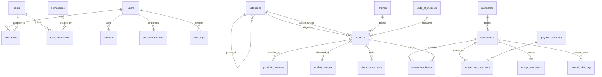

# Database Schema & ER Diagram — KassaRitel POS

Database menggunakan SQLite relasional (`node:sqlite` `DatabaseSync`) dengan migrasi SQL berurutan di `server/db/migrations/`:
1. `001_initial_pos.sql` — Inti POS, transaksi, mutasi stok, pengaturan toko, dan audit log.
2. `002_auth_rbac.sql` — Pengguna, role, izin granular, sesi ter-hash, dan otorisasi PIN.
3. `003_product_catalog.sql` — Master produk lengkap, multi-barcode, gambar referensi AI, kategori hierarkis, merek, dan satuan UOM.
4. `004_pos_core_checkout.sql` — Pelanggan (`customers`), metode pembayaran terkonfigurasi (`payment_methods`), generator urutan dokumen (`document_sequences`), pembayaran multi-metode (`transaction_payments`), status transaksi & pembayaran, diskon per baris/transaksi, override harga, dan kunci idempotensi.
5. `005_receipt_printing.sql` — Snapshot struk historis (`receipt_snapshots`), riwayat cetak & cetak ulang (`receipt_print_logs`), serta konfigurasi logo dan lebar kertas pada `store_settings`.

---

## Entity Relationship Diagram (Mermaid)

---

## Ringkasan Tabel & Indeks

### 1. Modul Autentikasi & RBAC (`002_auth_rbac.sql`)
- **`users`**: `id (PK)`, `username (UNIQUE NOCASE)`, `email (UNIQUE NOCASE)`, `full_name`, `password_hash`, `pin_hash`, `is_active`, `last_login_at`, `created_at`, `updated_at`.
- **`roles`**: `id (PK)`, `name (UNIQUE NOCASE)`, `description`, `is_system`, `created_at`.
- **`permissions`**: `id (PK)`, `code (UNIQUE)`, `module`, `action`, `label`, `description`.
- **`user_roles`**: `user_id (FK -> users)`, `role_id (FK -> roles)`, `assigned_at` (`PK: user_id, role_id`). Index: `idx_user_roles_role`.
- **`role_permissions`**: `role_id (FK -> roles)`, `permission_id (FK -> permissions)` (`PK: role_id, permission_id`). Index: `idx_role_permissions_perm`.
- **`sessions`**: `id (PK)`, `user_id (FK -> users)`, `token_hash (UNIQUE)`, `refresh_token_hash (UNIQUE)`, `user_agent`, `ip_address`, `login_at`, `last_activity_at`, `expires_at`, `refresh_expires_at`, `revoked_at`. Indexes: `idx_sessions_user_id`, `idx_sessions_token_hash`, `idx_sessions_refresh_hash`.
- **`pin_authorizations`**: `id (PK)`, `authorizer_user_id (FK -> users)`, `requested_by_user_id (FK -> users)`, `action`, `reason`, `token_hash (UNIQUE)`, `expires_at`, `used_at`, `created_at`.

### 2. Modul Master Produk & Katalog (`001_initial_pos.sql` + `003_product_catalog.sql`)
- **`categories`**: `id (PK)`, `name`, `slug (UNIQUE NOCASE)`, `parent_id (FK -> categories.id ON DELETE SET NULL)`, `description`, `is_active`, `created_at`, `updated_at`.
- **`brands`**: `id (PK)`, `name (UNIQUE NOCASE)`, `description`, `is_active`, `created_at`, `updated_at`.
- **`units_of_measure`**: `id (PK)`, `code (UNIQUE NOCASE)`, `name`, `is_system`, `is_active`, `created_at`.
- **`products`**: `id (PK)`, `sku (UNIQUE NOCASE)`, `barcode (UNIQUE)`, `name`, `description`, `brand_id`, `category_id`, `subcategory_id`, `category`, `uom_id`, `unit`, `variant`, `size`, `weight`, `volume`, `cost_price`, `sell_price`, `special_price`, `tax_category`, `stock`, `min_stock`, `status`, `primary_image_id`, `created_at`, `updated_at`.
- **`product_barcodes`**: `id (PK)`, `product_id (FK -> products ON DELETE CASCADE)`, `barcode (UNIQUE NOCASE)`, `barcode_type`, `is_primary`, `created_at`.
- **`product_images`**: `id (PK)`, `product_id (FK -> products ON DELETE CASCADE)`, `file_name`, `mime_type`, `file_size`, `image_url`, `storage_path`, `is_primary`, `is_ai_reference`, `reference_angle`, `ai_embedding_status`, `created_at`.

### 3. Modul POS Core, Pelanggan, Pembayaran & Stok (`001_initial_pos.sql` + `004_pos_core_checkout.sql`)
- **`customers`**: `id (PK)`, `code (UNIQUE NOCASE)`, `name`, `phone`, `email`, `address`, `notes`, `is_active`, `created_at`, `updated_at`.
  - Indexes: `idx_customers_name`, `idx_customers_phone`.
- **`payment_methods`**: `id (PK)`, `code (UNIQUE NOCASE)`, `name (UNIQUE NOCASE)`, `type` (`CASH` | `DEBIT` | `CREDIT` | `QRIS` | `OTHER`), `requires_reference`, `is_system`, `is_active`, `sort_order`, `created_at`.
- **`document_sequences`**: `seq_key (PK)`, `last_number`, `updated_at` (menjamin nomor `TRX-YYYYMMDD-0001` & `HOLD-YYYYMMDD-0001` unik secara atomik).
- **`transactions`**: `id (PK)`, `invoice_number (UNIQUE)`, `status` (`NEW` | `IN_PROGRESS` | `HELD` | `CANCELLED` | `COMPLETED`), `payment_status` (`UNPAID` | `PARTIAL` | `PAID` | `CANCELLED`), `customer_id (FK -> customers ON DELETE SET NULL)`, `customer_name`, `subtotal`, `line_discount_total`, `transaction_discount_type`, `transaction_discount_value`, `transaction_discount_amount`, `discount_amount`, `apply_tax`, `tax_amount`, `total`, `cash_received`, `change_amount`, `payment_method`, `total_cost`, `gross_profit`, `notes`, `idempotency_key (UNIQUE)`, `cashier_id`, `cashier_name`, `held_at`, `cancelled_at`, `completed_at`, `created_at`, `updated_at`.
  - Indexes: `idx_transactions_created_at`, `idx_transactions_status`, `idx_transactions_customer`, `idx_transactions_idempotency`.
- **`transaction_items`**: `id (PK)`, `transaction_id (FK -> transactions ON DELETE CASCADE)`, `product_id`, `sku`, `barcode`, `name`, `unit`, `qty`, `original_sell_price`, `sell_price`, `price_override`, `cost_price`, `line_discount_type`, `line_discount_value`, `line_discount_amount`, `tax_category`, `tax_amount`, `subtotal`.
  - Index: `idx_transaction_items_trx`.
- **`transaction_payments`**: `id (PK)`, `transaction_id (FK -> transactions ON DELETE CASCADE)`, `payment_method_id (FK -> payment_methods ON DELETE SET NULL)`, `payment_method_name`, `payment_type`, `amount`, `tendered_amount`, `change_amount`, `reference_number`, `created_at`.
  - Index: `idx_transaction_payments_trx`.
- **`stock_movements`**: `id (PK)`, `product_id (FK -> products ON DELETE CASCADE)`, `product_name`, `barcode`, `type` (`PENJUALAN`, `RESTOK`, `OPNAME`, `STOK_AWAL`), `qty_delta`, `stock_before`, `stock_after`, `reference_id`, `notes`, `created_at`. Index: `idx_stock_movements_created_at`.
- **`store_settings`**: `id (PK=1)`, `store_name`, `store_address`, `store_phone`, `store_logo_url`, `receipt_paper_width` (`58mm` | `80mm` | `A4`), `receipt_show_logo`, `receipt_show_qr`, `receipt_header_note`, `receipt_footer`, `tax_enabled`, `tax_rate`, `cashier_name`.
- **`audit_logs`**: `id (PK)`, `action`, `entity_type`, `entity_id`, `actor_user_id`, `actor`, `summary`, `created_at`. Index: `idx_audit_logs_created_at`.

### 4. Modul Struk & Pencetakan (`005_receipt_printing.sql`)
- **`receipt_snapshots`**: `transaction_id (PK, FK -> transactions ON DELETE CASCADE)`, `receipt_number (UNIQUE)`, `verification_token`, `store_name`, `store_address`, `store_phone`, `store_logo_url`, `receipt_header_note`, `receipt_footer`, `tax_rate`, `print_count`, `last_printed_at`, `created_at`.
- **`receipt_print_logs`**: `id (PK)`, `transaction_id (FK -> transactions ON DELETE CASCADE)`, `copy_number`, `print_type` (`ORIGINAL` | `REPRINT`), `layout_format` (`58mm` | `80mm` | `A4` | `DIGITAL`), `driver_id`, `printed_by_user_id`, `printed_by_name`, `created_at`.
  - Index: `idx_receipt_print_logs_trx`.

